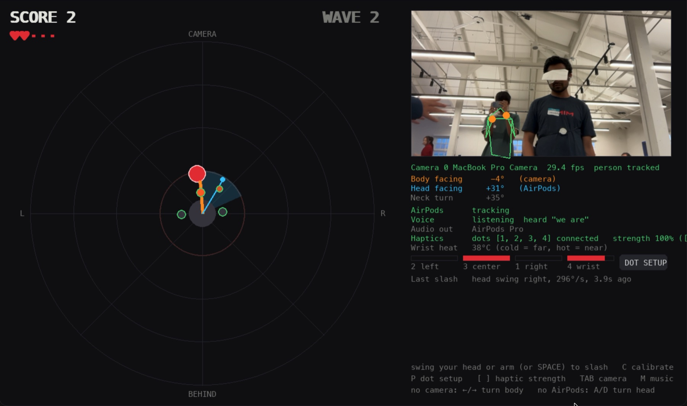

# Blind Samurai

**A sword-fighting game you play without your eyes.** Monsters close in from every side
and you can't see them. You hear them breathing in 3D audio that turns with your head, and
you feel them on your body through vibrating, heating dots. Find one, face it, and cut it down.

It's built for blind and low-vision players first: nothing in the game needs sight. Sighted
players get blindfolded, and it plays the same way, as a fight against monsters that are invisible.



*Playtest at the hackathon, 2026-10-10. The player is blindfolded; the screen is for
spectators. The red dot is a monster within striking range. The orange line is where their chest
faces (camera), the blue line where their head faces (AirPods), and the blue wedge is their sword's reach.*

## How you play

1. **Listen.** Each monster growls and stomps from its real position around you. Turning your
   head moves the sound, just like turning towards a real noise. Behind you sounds duller;
   straight ahead is clearest.
2. **Feel.** Dots on your left side, chest and right side buzz in the monster's direction. Both
   sides at once means it's behind you. The buzz gets stronger as it closes in.
3. **Track it on your wrist.** The wrist dot follows the closest monster. It warms up from
   cool (far) to hot (near), and vibrates at full strength when the monster is within reach
   and you're facing it. That's your cue.
4. **Strike.** Your head is the sword. Snap your head through the monster with a fast turn or
   a nod, or slash with your arm. A coin clink means you got it. A heavy thud and a
   heartbeat mean it got you.

You have five lives. Monsters come one at a time, from a random direction, and every three
monsters the next wave is faster. Say **"start game"** to begin.

## How it works

| Sense | Hardware | What it tells you |
|---|---|---|
| Hearing | AirPods Pro | Monsters, music and effects in 3D, re-aimed every audio block from your head direction |
| Touch | DataFeel dots (4) | Direction of the monster relative to your **body**; closeness by strength and wrist heat |
| Your body | Laptop camera + MediaPipe | Which way your chest faces, and arm slashes |
| Your head | AirPods Pro motion sensors | Where you're looking: aims the sword and steers the audio |
| Your voice | Mac microphone | "start game", "stop game" |

Head and body are tracked separately on purpose. You can keep your chest still and turn
your head to listen. The dots stay put relative to your body, and the sound moves with your head.

All sound is synthesized when the game starts. There are no audio files.

## What you need

- A Mac with Apple silicon, macOS 14 or newer, and a built-in camera
- **AirPods Pro** (or other AirPods with head tracking)
- A **DataFeel** dev kit (El Jefe + 4 dots). Optional: without it the game still runs on audio alone
- Xcode command line tools (`xcode-select --install`) for the small Swift helper
- [uv](https://docs.astral.sh/uv/) (`brew install uv`)

## Setup

```sh
git clone <this repo> blindsamurai && cd blindsamurai
./run.sh
```

The first run takes a minute. It does everything below on its own:

- creates `.venv` with Python 3.12 and the locked dependencies (mediapipe, opencv, pygame, ...)
- downloads the MediaPipe pose model into `models/`
- builds `headtracker/HeadTracker.app`, a small Swift helper that streams AirPods head motion
  and listens for voice commands

### Permissions (first launch)

macOS will ask a few times. Say yes to each:

| Prompt | For |
|---|---|
| Camera, for your terminal app | Body tracking |
| Motion & Fitness, for HeadTracker | AirPods head tracking |
| Microphone and Speech Recognition, for HeadTracker | "start game" |

If you said no by accident, turn them on in **System Settings → Privacy & Security**.
Every rebuild of the helper makes macOS ask again.

### Before each session

1. **Connect AirPods Pro** to the Mac and put both in.
2. **Turn on the DataFeel El Jefe.** The game connects over Bluetooth to the kit named
   `DataFeel36`. For another kit: `DATAFEEL_BLE=DataFeel3A ./run.sh`. Close any other app
   connected to it (like `dashboard.py`): El Jefe only takes one connection at a time.
3. **Wear the dots:** one on each side of your ribs, one on your sternum, one on the wrist of
   your sword hand.
4. **Map the dots.** Press **P** in the game. Press BUZZ next to each dot, feel where it is,
   and click the body part it's on. This is saved in `dots.json`.
5. **Stand back** so the camera sees you from the waist up, with both hands in frame.
6. **Face the camera and look at it, then press C** to calibrate body and head.
7. **Blindfold on. Say "start game".**

## Controls

| Input | Does |
|---|---|
| Swing your head (fast turn or nod) | Slash, cutting everything the swing passes through |
| Slash with your arm | Slash where your head points |
| "start game" / "stop game" | Start or stop a round |
| Space | Slash (for testing) |
| C | Calibrate: face and look at the camera first |
| P | Dot setup: map dots, test them, set strength |
| [ / ] | Haptic strength down / up |
| Tab | Next camera |
| M | Music on/off |
| R | Back to the title screen |
| Esc / Q | Quit |
| ← → and A D | Turn body / head by keyboard when there's no camera / AirPods |

## Options

```sh
./run.sh --sound-test             # sound board: play every sound from any direction
./run.sh --haptic-intensity 0.6   # overall haptic strength 0..1 (also BS_HAPTIC_INTENSITY)
./run.sh --camera 0               # pick a camera; --list-cameras shows them
./run.sh --no-camera --no-haptics --no-airpods   # keyboard-only, for development
```

| Environment variable | Default | Meaning |
|---|---|---|
| `DATAFEEL_BLE` | `DataFeel36` | Bluetooth name(s) of the El Jefe to use, comma-separated |
| `BS_HAPTIC_INTENSITY` | `1.0` | Starting haptic strength |
| `HEAD_YAW_SIGN` | `-1` | Set to `1` if turning your head moves sounds the wrong way |

The wrist dot's heat stays between 22 °C and 38 °C, and is never allowed outside 18–40 °C.
The dot holds that temperature using its own skin sensor. Heat and vibration switch off when
the game quits.

## Troubleshooting

- **Haptics: "DataFeel36 not found".** Another app holds the Bluetooth connection (often
  `dashboard.py`), or the El Jefe is off. A connected El Jefe stops advertising, so close
  the other app and restart the game.
- **AirPods: "waiting for AirPods".** Check they're connected and in your ears, and that
  HeadTracker is allowed under Privacy & Security → Motion & Fitness.
- **Voice line shows nothing heard.** Allow HeadTracker under Microphone and Speech
  Recognition. It always uses the Mac's built-in mic, so the AirPods stay in high-quality
  audio mode.
- **Body tracking follows the wrong person.** Only the player should be in the camera's
  view. MediaPipe tracks one person, and it may pick a bystander.
- **"unavailable: another copy of the game is using it".** Only one copy of the game or the
  sound test can use the AirPods at a time.

## Project layout

```
main.py               entry point (run through run.sh)
samurai/game.py       game loop, rules, display
samurai/pose.py       camera + MediaPipe: body facing, arm slashes
samurai/head.py       AirPods head direction, head-swing slashes, voice commands
samurai/haptics.py    DataFeel dots: direction, wrist vibration + heat, hit/kill effects
samurai/dotsetup.py   dot setup screen
samurai/audio.py      head-tracked spatial audio engine, loudness matching
samurai/sounds.py     every sound and the music, synthesized
samurai/soundtest.py  sound test board
headtracker/          Swift helper: CoreMotion headphone tracking + on-device speech
datafeel/             DataFeel SDK, with Bluetooth support
dashboard.py          web dashboard for poking at the dots by hand (.venv/bin/python dashboard.py)
```
